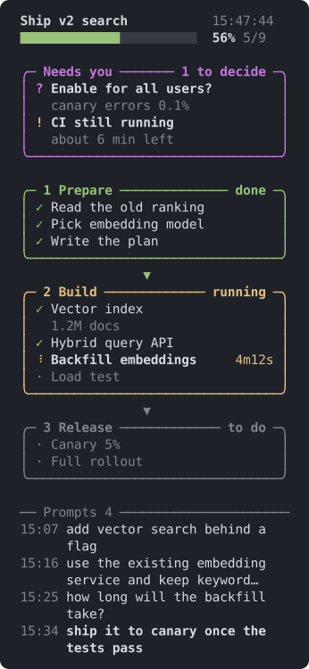

# rex-task-board

English | [简体中文](README.zh-CN.md)

A live task board for coding agents that run in the **Rex** terminal. The agent opens a pane next to its own and keeps it current: phases, progress, what needs you, and the prompts you have sent so far, all at a glance instead of buried in scrollback.

<p align="center"></p>

## What you get

- **Phases and progress**: one box per phase, joined by arrows, under an overall progress bar. Running items spin and show how long they have been running.
- **"Needs you"**: decisions waiting on you (`?`), things to keep an eye on (`!`) and blockers (`✗`) sit right under the progress bar.
- **Your prompts**: docked at the bottom (at most 30% of the pane), newest last. They are read from the agent's own session transcript, so the agent does nothing extra to keep them current.
- **Any pane height**: when space runs short the board compacts step by step, keeps the header in place and follows the work in progress (see below).
- **Mouse and keys**: the wheel scrolls whatever is under the pointer. Click a folded phase (`▸`) or an "N done" line to open it, click a phase title to fold it, click a prompt cut with `…` to read all of it. `↑` `↓` `j` `k` `PgUp` `PgDn` `g` `G` scroll the prompts.
- **English or Chinese** interface.
- Python standard library only. Nothing leaves your machine.

## Requirements

- Rex with the `rex` command on your `PATH`. Outside Rex the skill stays out of the way.
- Python 3.9 or later, and zsh (the macOS default).
- An agent that supports [Agent Skills](https://agentskills.io), such as Claude Code or Codex. The prompt list reads Claude Code and Codex transcripts.

## Install

**Claude Code plugin**

```text
/plugin marketplace add foriLLL/rex-task-board
/plugin install rex-task-board@rex-task-board
```

**Plain skill** (Claude Code, Codex or any tool that loads Agent Skills)

```bash
git clone https://github.com/foriLLL/rex-task-board.git ~/src/rex-task-board
ln -s ~/src/rex-task-board/skills/rex-task-board ~/.claude/skills/rex-task-board   # Claude Code
ln -s ~/src/rex-task-board/skills/rex-task-board ~/.codex/skills/rex-task-board    # Codex
```

`git pull` updates it, and open boards reload themselves.

Then work as usual. When a task has several steps or something needs your call, the agent opens the board on its own.

## How it works

```text
agent ── set.py ──▶ board.json ──▶ board.py   (Rex pane, redrawn every 0.5 s)
                                      ▲
session transcript (.jsonl) ──────────┘ your prompts
```

- `open.sh` splits the agent's Rex pane and starts `board.py` in the new pane.
- The agent only edits the state file through `set.py`. Every write is atomic, and every write also records the agent's transcript path (found through `CLAUDE_CODE_SESSION_ID` or `CODEX_THREAD_ID`).
- `board.py` redraws from the state file and reads the transcript incrementally: only the bytes added since the last redraw.

## Use it by hand

```bash
S=skills/rex-task-board/scripts
B=/tmp/board/board.json && mkdir -p /tmp/board
python3 $S/set.py $B init "Ship v2 search" --lang en
python3 $S/set.py $B phase "Build" "Vector index" "Hybrid query API" "Load test"
python3 $S/set.py $B mark "Vector index" run
python3 $S/set.py $B attn decide "Enable for all users?" --note "canary errors 0.1%"
zsh $S/open.sh $B          # inside Rex; optional width in percent, default 27
python3 $S/set.py          # every command
```

Item states are `todo`, `run`, `done`, `ask` (waiting on you), `fail` and `skip` (not counted).

## When the pane is short

The board stops at the first step that makes it fit:

1. Fold finished phases into one line, oldest first.
2. Drop the notes of finished items.
3. Collapse finished items into one "N done" line.
4. Fold phases that have not started.
5. Fold phases with nothing running, waiting or failed.

If it still does not fit, the title, progress bar and "Needs you" box stay fixed while the phases scroll, following the first phase with a running, waiting or failed item. After you scroll by hand it leaves you alone for 30 seconds. A click always wins: a phase you open stays open and one you fold stays folded.

## Prompt history

The list shows what you typed: tool results, injected reminders, skill bodies, slash commands without arguments and local command output are dropped. Images show as `[image]` and pasted blocks as `[pasted]`. After `/clear` the list follows the new session.

```bash
python3 $S/set.py $B queries                # numbered list
python3 $S/set.py $B query "short label"    # show a label instead of the latest prompt (--n K for prompt K)
python3 $S/set.py $B history off            # hide the list; or pass a JSONL path to pin the source
```

Labels are shown in cyan in place of the prompt. Agents without a supported transcript can still add entries with `query`.

## State file

`set.py` covers everyday edits. If you write the JSON yourself, replace the whole file at once; the board keeps showing the last readable state.

```json
{
  "title": "Task title",
  "lang": "en",
  "attention": [{"k": "decide|watch|block", "t": "text", "note": "detail"}],
  "phases": [{"name": "Phase", "items": [
    {"s": "todo|run|done|ask|fail|skip", "t": "item", "note": "detail", "start": "HH:MM:SS"}
  ]}],
  "log": "/abs/path/to/log (optional: last lines shown under the phases)",
  "log_lines": 4,
  "transcript": "/path/to/session.jsonl (written by set.py)",
  "query_notes": {"<prompt id>": "label"},
  "history_ratio": 0.3,
  "history_wrap": 2
}
```

`lang` is `en` or `zh`; without it the board follows the locale (`LC_ALL`, `LC_MESSAGES`, `LANG`).

## Development

```text
skills/rex-task-board/
  SKILL.md           instructions the agent reads
  scripts/
    set.py           edit the state file
    board.py         draw the board, handle mouse and keys
    history.py       find and read session transcripts
    open.sh close.sh open or close the Rex pane
tests/               unit tests (python3 -m unittest discover -s tests)
tools/demo_svg.py    draws docs/demo.svg from the real renderer
```

```bash
python3 -m unittest discover -s tests
python3 tools/demo_svg.py en docs/demo.svg && python3 tools/demo_svg.py zh docs/demo.zh-CN.svg
```

A running board re-executes itself when `board.py` or `history.py` changes, so you can restyle it live.

## License

[MIT](LICENSE)
