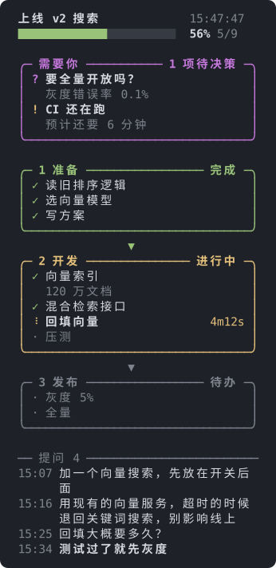

# rex-task-board

[English](README.md) | 简体中文

给在 **Rex** 终端里干活的编程 Agent 用的实时任务看板。Agent 在自己的 pane 旁边开一个看板并随进度更新：阶段、进度、需要你处理的事、你发过的提问，一眼就能看到，不用去翻滚动记录。

<p align="center"></p>

## 能看到什么

- **阶段和进度**：每个阶段一个框，用箭头连起来，上面是总进度条。进行中的项会转圈，并显示已用时长。
- **「需要你」**：等你拍板的事（`?`）、需要留意的事（`!`）和阻塞项（`✗`），就在进度条下面。
- **你的提问**：吸底显示，最多占 pane 的 30%，最新的在最下面。直接从 Agent 自己的会话记录里读，Agent 不需要额外维护。
- **适配任意高度**：放不下时逐步压缩，顶部固定，并自动跟到正在进行的工作（见下文）。
- **鼠标和按键**：滚轮滚动指针下的区域。点击折叠的阶段（`▸`）或「N 项已完成」展开，点击阶段标题折叠，点击被截成 `…` 的提问看全文。`↑` `↓` `j` `k` `PgUp` `PgDn` `g` `G` 滚动提问区。
- 界面支持**中文和英文**。
- 只用 Python 标准库，数据不出本机。

## 环境要求

- Rex，并且 `rex` 命令在 `PATH` 里。不在 Rex 里时这个 skill 什么也不做。
- Python 3.9 及以上，以及 zsh（macOS 默认就有）。
- 支持 [Agent Skills](https://agentskills.io) 的 Agent，比如 Claude Code、Codex。提问历史能读取 Claude Code 和 Codex 的会话记录。

## 安装

**Claude Code 插件**

```text
/plugin marketplace add foriLLL/rex-task-board
/plugin install rex-task-board@rex-task-board
```

**作为普通 skill**（Claude Code、Codex 或其他支持 Agent Skills 的工具）

```bash
git clone https://github.com/foriLLL/rex-task-board.git ~/src/rex-task-board
ln -s ~/src/rex-task-board/skills/rex-task-board ~/.claude/skills/rex-task-board   # Claude Code
ln -s ~/src/rex-task-board/skills/rex-task-board ~/.codex/skills/rex-task-board    # Codex
```

`git pull` 即可更新，已打开的看板会自动重新加载。

装好后照常使用。任务有多个步骤或有事需要你决定时，Agent 会自己打开看板。

## 工作方式

```text
Agent ── set.py ──▶ board.json ──▶ board.py   （Rex pane，每 0.5 秒重绘）
                                      ▲
会话记录 (.jsonl) ────────────────────┘ 你的提问
```

- `open.sh` 在 Agent 的 Rex pane 右侧分出一个 pane，在里面运行 `board.py`。
- Agent 只通过 `set.py` 改状态文件，每次写入都是原子的，并顺带记下 Agent 的会话记录路径（通过 `CLAUDE_CODE_SESSION_ID` 或 `CODEX_THREAD_ID` 找到）。
- `board.py` 按状态文件重绘，会话记录只增量读取上次之后新增的部分。

## 手动使用

```bash
S=skills/rex-task-board/scripts
B=/tmp/board/board.json && mkdir -p /tmp/board
python3 $S/set.py $B init "上线 v2 搜索" --lang zh
python3 $S/set.py $B phase "开发" "向量索引" "混合检索接口" "压测"
python3 $S/set.py $B mark "向量索引" run
python3 $S/set.py $B attn decide "要全量开放吗？" --note "灰度错误率 0.1%"
zsh $S/open.sh $B          # 需在 Rex 里；可选宽度百分比，默认 27
python3 $S/set.py          # 查看全部命令
```

项的状态：`todo` 待办、`run` 进行中、`done` 完成、`ask` 等你定、`fail` 失败、`skip` 不做（不计入进度）。

## pane 不够高时

按下面的顺序逐步压缩，放得下就停：

1. 已完成的阶段折叠成一行，从最早的开始。
2. 去掉已完成项的备注。
3. 已完成项合并成一行「N 项已完成」。
4. 折叠还没开始的阶段。
5. 折叠没有进行中、待定或失败项的阶段。

还放不下时，标题、进度条和「需要你」框固定不动，只滚动阶段区，并跟到第一个有进行中、待定或失败项的阶段。你手动滚动后，30 秒内不会被拉回去。点击永远优先：你展开的阶段保持展开，你折叠的保持折叠。

## 提问历史

只显示你实际输入的内容：工具结果、注入的提醒、skill 正文、不带参数的斜杠命令和本地命令输出都会过滤掉。图片显示为 `[image]`，粘贴的大段内容显示为 `[pasted]`。`/clear` 之后自动切到新会话。

```bash
python3 $S/set.py $B queries                # 带编号列出提问
python3 $S/set.py $B query "一句话概括"       # 用概括替换最新一条的显示（--n K 指定第 K 条）
python3 $S/set.py $B history off            # 不显示；也可以传 JSONL 路径固定来源
```

概括以青色显示，替换原话。没有可读会话记录的 Agent 也可以用 `query` 手动加记录。

## 状态文件

日常修改用 `set.py` 就够了。如果直接写 JSON，请整体替换文件；看板会一直显示最后一次能读到的状态。

```json
{
  "title": "任务标题",
  "lang": "zh",
  "attention": [{"k": "decide|watch|block", "t": "事项", "note": "补充"}],
  "phases": [{"name": "阶段", "items": [
    {"s": "todo|run|done|ask|fail|skip", "t": "项", "note": "补充", "start": "HH:MM:SS"}
  ]}],
  "log": "/abs/path/to/log（可选，在阶段下面显示最后几行）",
  "log_lines": 4,
  "transcript": "/path/to/session.jsonl（set.py 自动写入）",
  "query_notes": {"<提问 id>": "概括"},
  "history_ratio": 0.3,
  "history_wrap": 2
}
```

`lang` 为 `en` 或 `zh`；不填时跟随系统语言（`LC_ALL`、`LC_MESSAGES`、`LANG`）。

## 开发

```text
skills/rex-task-board/
  SKILL.md           Agent 读的说明
  scripts/
    set.py           修改状态文件
    board.py         绘制看板，处理鼠标和按键
    history.py       查找并读取会话记录
    open.sh close.sh 打开或关闭 Rex pane
tests/               单元测试（python3 -m unittest discover -s tests）
tools/demo_svg.py    用真实渲染器生成 docs/demo.svg
```

```bash
python3 -m unittest discover -s tests
python3 tools/demo_svg.py en docs/demo.svg && python3 tools/demo_svg.py zh docs/demo.zh-CN.svg
```

运行中的看板在 `board.py` 或 `history.py` 变化时会自动重新执行，改样式可以实时看到效果。

## 许可证

[MIT](LICENSE)
